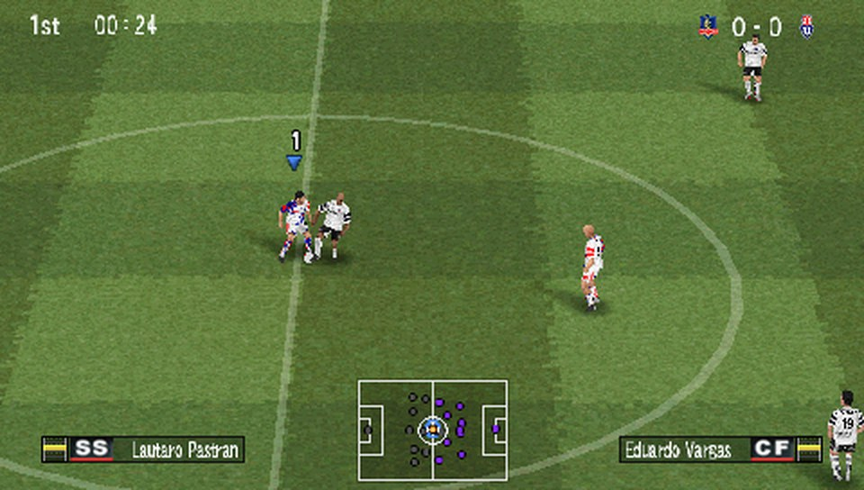
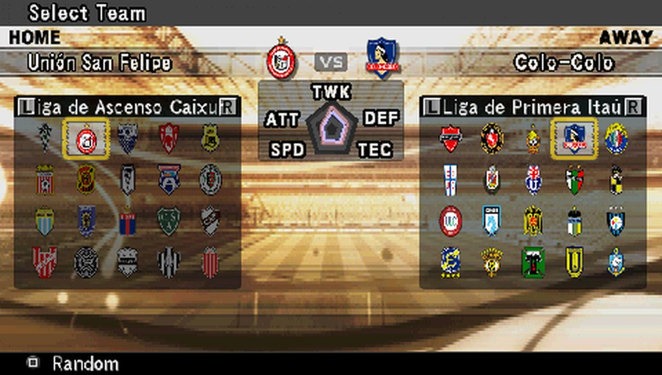

  

<h1 align="center">PES6</h1>

  <b>Pro Evolution Soccer 6 (PSP), running natively on Android — no emulator.</b>

  <a href="../../releases/latest"><b>⬇ Download the APK</b></a> · bring your own PES6 ISO

  
  

---

## Features

- **The whole game:** every mode, with real saves.
- **Made for a phone:** touch controls with several layouts, gamepad support, widescreen, 30 or 60 fps matches.
- **Online:** rooms on a lobby server, with matches played directly between phones.
- **Local multiplayer:** the game's WIRELESS mode over Wi-Fi or Wi-Fi Direct.
- **Patches:** install and remove them from the app. The Chilean league comes preinstalled.
- **Commentary** in the language of your own PS2 copy.

## How it works

- **Static recompilation:** the game's PSP code is translated ahead of time to native ARM64. It is not emulated.
- **System layer:** a runtime that replaces the PSP's firmware, graphics, audio and network.
- **Your own copy:** the app contains no game data. On first launch you choose your PES6 ISO and the app prepares it on
  the phone.
- **Online:** a small lobby server introduces the players. The match itself goes from phone to phone.

## Getting started

1. Download `PES6-<version>.apk` from [**Releases**](../../releases/latest) and install it.
2. Put your PES6 ISO (PSP, Europe, `ULES00476`) in **Downloads**.
3. Open **PES6**, tap **ISO**, choose the file and wait until it is ready.

You need a 64-bit ARM phone with Android 8 or newer and about 2 GB free. New versions install over the old one and keep
your saves.

## Building

You need your own copy of the game. Desktop (macOS/Linux) and Android builds are described in `docs/14-android.md` and
`AGENTS.md`.

## Credits

- **PECH:** the PES6 PC patch the Chilean league comes from, with commentary by **Claudio Palma**.
- **[psprecomp](https://github.com/sp00nznet/psprecomp)** by sp00nznet: the recompiler this port grew from.
- **[pspdecrypt](https://github.com/John-K/pspdecrypt)** by John-K: the PRX decrypter.
- **[PPSSPP](https://www.ppsspp.org):** the reference everything was checked against.

## Legal

This repository and the APK contain no PES6 executables, data, audio or textures. Everyone needs their own copy of the
game. Pro Evolution Soccer is a trademark of Konami. This project is not affiliated with Konami or Sony.

Licensed under the **GNU GPL-3.0** (`LICENSE`). `third_party/psprecomp` is MIT and `third_party/pspdecrypt` is GPL-3.0.
The Chilean league data belongs to its authors (PECH); club names and crests belong to their clubs.
