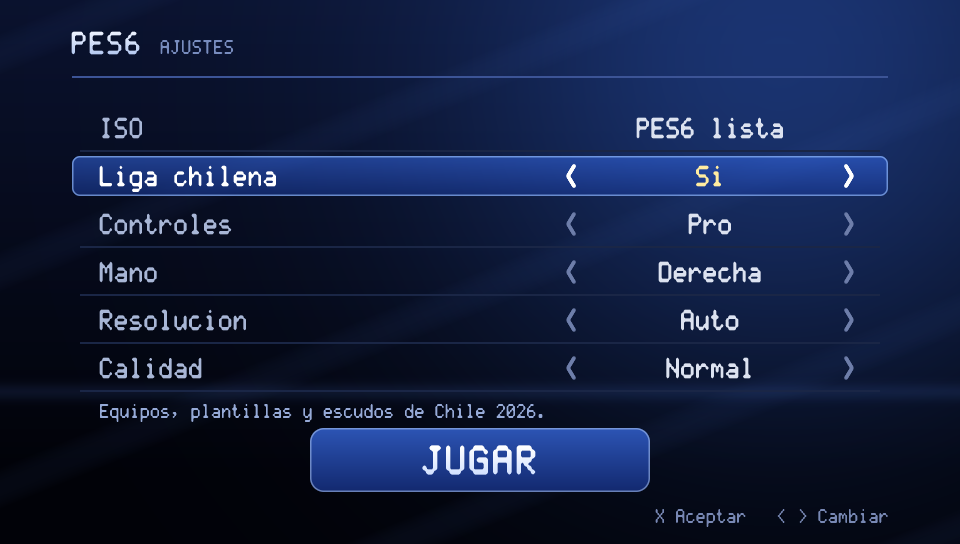

<p align="center">
  
</p>

<h1 align="center">PES6</h1>

<p align="center">
  <b>Pro Evolution Soccer 6 (PSP), running natively on Android and desktop — no emulator.</b><br>
  With the 2026 Chilean league built in, and the factory game one switch away.
</p>

<p align="center">
  <a href="../../releases/latest"><b>⬇ Download the APK</b></a> · bring your own PES6 ISO
</p>

<p align="center">
  
  
</p>

---

## What you get

### ⚽ The whole game, native
- Every mode of the original: **Exhibition, Master League, League, Cup, Training, Edit, Options**,
  penalties and the national teams.
- The game's own code, translated ahead of time to native ARM64 / x86-64: **30 fps in matches on a
  budget phone** (Redmi Note 13), with the game's logic and timing untouched.
- **Real saves**: League, Cup and Master League carry on where you left them. The app pauses and
  resumes like any other.

### 🇨🇱 Liga chilena 2026
- **Primera División and Primera B (Ascenso)** of Chile, with their real names, crests, kits and
  colours.
- **Squads as of October 2026 for every league in the game** — Chile, Argentina, Brazil, the rest
  of South America and Europe — with transfers, new signings and shirt numbers.
- **Player faces** for some 4,000 players; new players get skin, hair and beard that fit.
- **Spanish commentary by Claudio Palma**, with goal calls, player names and the score.
- **Menu music** of your own, a different song each time.

### 🔀 One switch: Chilean league or factory game
The start menu has a **Liga chilena: Sí / No** setting.
- **Sí** — everything above.
- **No** — PES6 exactly as it came out of the box: Konami's teams, crests, music and menus, and
  its own saves, kept apart from the Chilean ones.

<p align="center">
  
</p>

### 📱 Made for a phone
- **Touch controls drawn on screen**, in four layouts:
  - **Clásico**: stick that sprints at its edge, the PSP's buttons;
  - **Cruceta**: fixed d-pad, R to sprint;
  - **Pro** (default): fine stick that sprints in its outer ring, big buttons, swipe a button up
    for +L or down for +R, with a vibration tick;
  - **Pro atajos**: like Pro, with L/R combos as buttons of their own.
- **Left- or right-handed** layout.
- **Gamepads**: plug one in and the touch controls step aside.
- **Widescreen match** that fills the phone's screen, notch included.
- **Resolution**: automatic for your phone's GPU, or fixed at 1×, 2× or 3×. **Quality**: sharp,
  PSP-like or smoothed.

### 📶 Multiplayer
The game's **WIRELESS mode** works between two phones, or a phone and a computer: on the same
Wi-Fi, or phone to phone with **Wi-Fi Direct**, no router needed. Both players see the same match.

### 💿 Bring your own copy
The app contains no game data. On first launch it asks for **your own PES6 ISO** (PSP, Europe,
`ULES00476`). It checks the ISO, decrypts the game on the phone and copies it into the app.
After that, it just plays.

---

## Getting started (Android)

1. Download `PES6-<version>.apk` from [**Releases**](../../releases/latest) and install it
   (Android will ask you to allow installing apps from your browser or file manager).
2. Put your PES6 ISO somewhere you can browse to on the phone, for example **Downloads**. It must
   be the European release, `ULES00476`; the app checks it and tells you if it is another one.
3. Open **PES6**, tap **ISO** and choose the file. You'll see *Copiando N%* and then *PES6 lista*.
   Once copied, you may delete the ISO from Downloads.
4. Pick **Liga chilena: Sí** or **No**, set your controls and tap **Jugar**.

Needs a 64-bit ARM phone with Android 8 or newer and OpenGL ES 3, and about 2 GB free (1.2 GB of
it for the copy of the ISO). New versions install over the old one and keep your saves.

The APK contains no Konami game data: no ISO, no executable, no graphics or sound from the disc.
You need your own copy of the game.

## Controls

| On screen | Gamepad | Keyboard (desktop) |
|---|---|---|
| Stick / d-pad | Left stick, d-pad | Arrow keys |
| ✕ ○ □ △ | A B X Y (by position) | X C Z S |
| L / R (swipes in Pro) | Bumpers or triggers | Q / W |
| Start | Start | Return |

The full list for the desktop window is in `docs/10-window-realtime-perf.md` and
`docs/19-menu-ajustes.md`.

---

## Technical overview

PES6 for PSP is a 1.9 MB MIPS executable plus 36 code overlays that load per screen (menus,
match, Master League, edit…). An emulator interprets that code instruction by instruction. This
project **translates it to C once**, with a static recompiler, and links it with a runtime that
stands in for the PSP's firmware at the system-call level (HLE). The result runs as native code,
and can be read, named, measured and changed.

```
 EBOOT.BIN (encrypted) --pspdecrypt--> EBOOT.elf --allegrexrecomp emit--> build/gen/*.c
 over.afs (36 MWo3 overlays) --tools/afs_overlays.py + tools/ovl_recomp.py--> build/gen_ovl/*.c
                                                                                |
      third_party/psprecomp   runtime: CPU state, memory, VFPU, firmware HLE    |
      runtime/common          GE, audio, video, network, menus, the game by name|
      runtime/desktop (SDL2)  or  runtime/android (NativeActivity)              v
                                              pes6 (desktop)  /  PES6 app (Android)
```

- **Recompiler** (`third_party/psprecomp`, from
  [sp00nznet/psprecomp](https://github.com/sp00nznet/psprecomp), MIT): decodes the Allegrex
  (MIPS32r2 with Sony's extensions and the VFPU), finds the functions and emits one C function per
  game function, with guaranteed tail calls so loops split across functions use no stack.
- **Overlays**: each one is recompiled at its load address and registered when the game loads it.
- **HLE runtime**: cooperative thread scheduler and a virtual clock tied to real time; files
  served straight from the ISO; display, pad, audio, ATRAC3plus, MPEG/H.264, utilities and ad hoc
  networking.
- **GE**: the PSP's graphics chip reimplemented — display lists, skinning, paletted and swizzled
  textures, morphing — rasterized in software (the reference) or on the GPU (OpenGL 3.3 / GLES 3).
- **The game by name**: addresses live only in `runtime/common/pes6_addrs.h`; `pes6_types.h`
  and `pes6_game.h` describe the match structures; `pes6_tuning.h` and `pes6_hooks.h` expose
  parameters and replaceable functions. All 19,193 functions are decompiled to readable C, about
  11,000 of them named.
- **Multiplayer**: `runtime/common/net.c` implements `sceNetAdhoc`, `Adhocctl` and `Matching`
  over UDP, with redundant datagrams and voice-class QoS.
- **ISO on the phone**: `runtime/common/iso_eboot.c` finds the EBOOT in the ISO9660 tree and
  decrypts it with pspdecrypt's PRX decrypter (`third_party/pspdecrypt`).

The layer map is in `docs/26-capas.md` and `runtime/README.md`; the game's own architecture in
`docs/22-arquitectura.md`.

### Requirements

- Your own copy of PES6 for PSP (Europe, `ULES00476`).
- macOS or Linux with cmake, clang, Python 3 and SDL2; FFmpeg (libavcodec) for video and music.
- Android: SDK build-tools and a platform, NDK and a JDK. No Gradle.
- For analysis: Ghidra 12 with ghidra-allegrex and JDK 21 (`AGENTS.md` §3, §6).

### Building on desktop

```bash
# 1. the game: your ISO in data/pes6.iso, the decrypted executable in build/EBOOT.elf
cp "<your copy>.iso" data/pes6.iso
mkdir -p data/extracted
AR=./third_party/psprecomp/build/tools/allegrexrecomp/allegrexrecomp
cmake -S third_party/psprecomp -B third_party/psprecomp/build && cmake --build third_party/psprecomp/build -j
$AR extract data/pes6.iso SYSDIR data/extracted
./vendor/pspdecrypt/pspdecrypt data/extracted/PSP_GAME_SYSDIR_EBOOT.BIN -o build/EBOOT.elf
python3 tools/afs_overlays.py data/pes6.iso build/overlays

# 2. recompile to C (executable and overlays) and build the host
python3 tools/names/build_names.py
ALLEGREX_NAMES=tools/names/pes6_eboot.txt ALLEGREX_SEEDS=build/seeds_ghidra_ppsspp.txt \
  $AR emit build/EBOOT.elf build/gen pes6
python3 tools/ovl_recomp.py
cmake -S runtime/desktop -B runtime/desktop/build && cmake --build runtime/desktop/build -j

# 3. play
./runtime/desktop/build/pes6 build/EBOOT.elf --window --gpu
```

The seed list (`build/seeds_ghidra_ppsspp.txt`) comes from Ghidra's analysis and PPSSPP's
symbol file (`docs/07`, `AGENTS.md` §6). Without `--window` the game runs headless under a
watchdog and prints a report of scenes, threads, I/O and GE when it stops.

### Building the Android app

```bash
tools/android_ffmpeg.sh                # once: static FFmpeg for the NDK
tools/android_build.sh iso [install]   # pes6port-iso.apk: asks for the ISO in its menu
VERSION=1.1 tools/android_build.sh iso release   # the Releases APK, signed with your own key
tools/android_build.sh mods [install]  # the league data, game data pushed by adb
```

Details in `docs/14-android.md` and `docs/35-apk-iso.md`.

### Modding

- **Parameters**: run acceleration, deceleration, ball gravity, clock speed (`tuning.txt`,
  `docs/25` §2).
- **Rules**: game functions replaced by C, such as no offside or no fouls (`rules.txt`,
  `docs/25` §3).
- **Textures**: replaced by texel hash from `mods/<mod>/textures/`; `PES6_TEX_DUMP` dumps them
  (`docs/17`).
- **Disc data**: `mods/<id>/afs/<archive.afs>/<slot>.bin` replaces a member of the disc's
  archives as it is read — crests, or any other resource (`docs/28` §3.1).
- **Music**: `tools/music_replace.py` puts any song in place of a game track (`docs/11` §8).
- **Leagues and seasons**: `tools/league_version.sh` turns a PES6 PC patch's option file into a
  version with its own saves; `tools/roster_update.py` refreshes squads from Wikipedia
  (`docs/28`, `docs/33`).
- **Code**: readable C of the whole game under `build/decomp/` (`tools/names/export_decomp.sh`,
  `docs/20`).

### Verification

`tools/regress.sh` compares deterministic captures at fixed points of the game against
`tools/regress/expected.txt` by MD5. Run it after touching the recompiler, the GE or the HLE.
`tools/check_layers.sh` checks that each layer only uses what it should.

### Repository layout

```
PES6PORT/
├─ docs/            technical notes by topic (start with 22, 25 and 26)
├─ runtime/
│  ├─ common/       shared code: GE, audio, video, network, menus, the game by name
│  ├─ desktop/      SDL2 host (macOS/Linux)
│  └─ android/      Android host (C and a little Java)
├─ third_party/
│  ├─ psprecomp/    PSP recompiler and runtime, with this project's changes
│  └─ pspdecrypt/   the PRX decrypter and KIRK engine, for the ISO on the phone
├─ tools/           overlays, names, Ghidra, Android, network, regression, rosters
├─ data/  build/  vendor/  mods/   local only, not versioned
└─ AGENTS.md        working notes and commands for contributors
```

## Credits

- **PECH** — the PES6 PC patch the Chilean league comes from:
  teams, crests, kits, faces and the commentary bank recorded by **Claudio Palma**.
- **[psprecomp](https://github.com/sp00nznet/psprecomp)** by sp00nznet — the recompiler and runtime
  this port grew from.
- **[pspdecrypt](https://github.com/John-K/pspdecrypt)** by John-K — the PRX decrypter and KIRK
  engine.
- **[PPSSPP](https://www.ppsspp.org)** — the reference everything was checked against.
- Squads from Spanish-language Wikipedia; menu music and app icon by the author.

## Legal

A research and interoperability project built on a personally owned copy of the game. This
repository contains no PES6 executables, overlays, data, audio or textures: everyone needs their
own copy. The published APK contains the port and the league data but nothing from the disc; APKs
built with game data inside are for personal use only and are never distributed.
Pro Evolution Soccer is a trademark of Konami. This project is not affiliated with Konami or Sony.

This project is licensed under the **GNU GPL-3.0** (`LICENSE`). Third-party code keeps its own
licence: `third_party/psprecomp` (MIT, see its `LICENSE` and `UPSTREAM.md`) and
`third_party/pspdecrypt` (GPL-3.0). The Chilean league data in the APK belongs to its authors
(PECH); club names and crests belong to their clubs.
